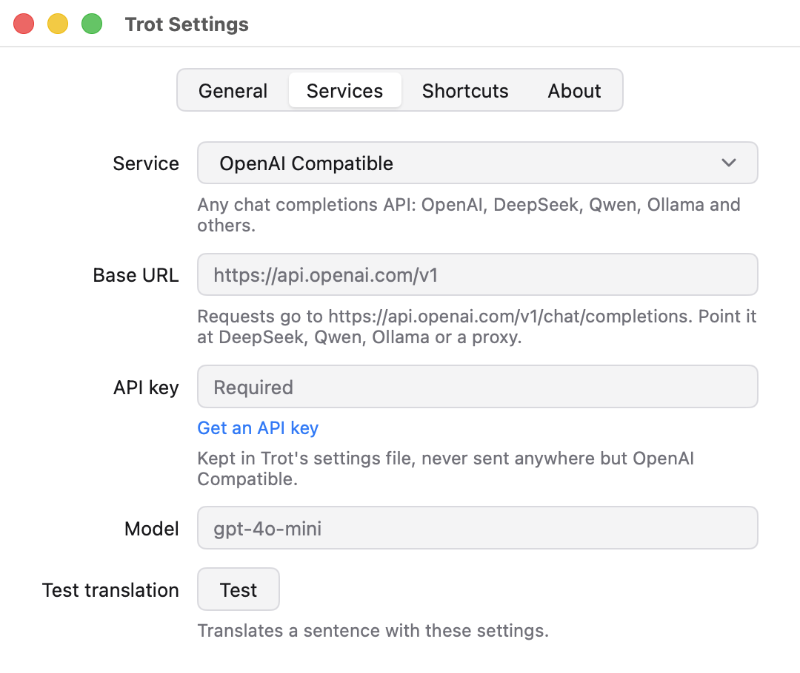

# Settings and data

## Settings

Settings opens from the menu bar icon, with ⌘, while a Trot window is key, or by opening Trot again while it runs. Changes save as you make them. Each pane is a form, a title on the left and its control on the right, with notes under a row.

| Pane | Setting | Default | Notes |
|---|---|---|---|
| General | First language | 简体中文 | The target for text in any other language |
| General | Second language | English | The target for text already in the first language. Picking the same language for both swaps them |
| General | Open Trot at login | off | Through the system login items, which needs the app bundle. When macOS refuses, the row says why |
| General | Accessibility | | Shows whether the permission is granted, with a button to System Settings while it isn't |
| General | Screen Recording | | The same for the permission screenshots need. macOS reports a grant only after Trot is opened again |
| General | Crash reports | on | Sends the report of a crash to Mon at the next launch, anonymously, with the home folder taken out |
| Services | Service | Mon | The active service, also switchable in the panel. Settings saved before Mon became the default keep OpenAI Compatible, which they used |
| Services | Mon account | signed out | With Mon picked, or while signing in: Sign In…, the code to approve as Trot waits, then your name with Sign Out, Sync Now, Manage Account and when the settings last synced |
| Services | Base URL | per service | OpenAI Compatible: `https://api.openai.com/v1`. Claude: `https://api.anthropic.com`. Point it at DeepSeek, Qwen, Ollama or a proxy. A missing scheme is added (`http` for localhost and `.local` names, `https` otherwise) and a pasted endpoint path dropped; the pane shows the URL requests go to |
| Services | API key | empty | DeepL keys ending in `:fx` use the free API. A link under it opens the page where the service hands out keys |
| Services | Model | per service | Mon: `deepseek-flash`. OpenAI Compatible: `gpt-4o-mini`. Claude: `claude-opus-5-5`. Mon's lists the models your account can use |
| Services | Test translation | | Translates a sentence with the current settings, from English into whatever English goes to, and shows the result or the error |
| Shortcuts | Translate Selection | ⌥D | Click, then press a combination with ⌘, ⌥ or ⌃. The held modifiers show as you press them. Delete clears it and Escape cancels. The hotkeys pause while you record, so a combination Trot already uses can be recorded. The arrow button goes back to the default and is enabled only for a changed shortcut |
| Shortcuts | Translate Input | ⌥A | |
| Shortcuts | Translate Screenshot | ⌥S | |
| About | | | The version, a short description and links to the project |

Every pane is the same width, and the window grows and shrinks with the pane from its top edge.

<p align="center">
  
</p>

Shortcuts are registered system-wide through Carbon hotkeys, which work without the Accessibility permission. They are stored as the keys' places on a US keyboard, so they stay put under any layout. When macOS refuses a combination, the pane says so.

## Services

| Service | How | Streams |
|---|---|---|
| Mon | `POST https://mon.sorrycc.dev/api/v1/ai/v1/messages`, Mon's AI gateway, which speaks the Messages API, with your account's token as the key. A `401` signs Trot out; a `429` says when to try again, from `Retry-After` | yes |
| OpenAI Compatible | `POST {base}/chat/completions` with a translation system prompt. A gateway that ignores `stream` and answers with one JSON message works too | yes |
| Claude | `POST {base}/v1/messages`. Claude 5 models run at low effort with Anthropic's server-side fallback, so a safety decline reruns on a fallback model. A model that thinks first shows Thinking… | yes |
| DeepL | `POST /v2/translate` on the free or Pro host, chosen by the key's suffix | no |
| Google | The `translate_a/single` endpoint Google's web client uses, with the text in a form body. No key. Unofficial, so it can stop working | no |

DeepL and Google are told the source language only when the script makes it certain (Chinese, Japanese, Korean, Thai); for everything else they detect it themselves, which beats a local guess on a short string or a script several languages share. The LLM services always get the detected language as a hint.

The connection to the service opens when a hotkey is pressed, whichever service it is, so its setup overlaps with reading the selection. Requests give up after 30 seconds without data and 3 minutes in all. A reply that isn't a translation, such as a web page from a wrong base URL, is shown as an error rather than an empty result, and so are an empty translation and one the service cut off at its output limit. A status code with no message of its own reads as a sentence, such as "The API key was rejected (HTTP 401)". Errors that Settings can fix, a missing or rejected key or a wrong base URL, come with an Open Settings button; Google, which has nothing to set, gets Retry.

## Settings sync

Signed in to Mon, Trot keeps one settings document in your account, `/api/v1/settings/trot`, as `{"settings": {…}}` with the keys of `settings.json`. What syncs: `firstLanguage`, `secondLanguage`, `service`, `service.<service>.baseURL`, `service.<service>.model` and `shortcut.<action>`. What doesn't: API keys, `mon.token`, `sendCrashReports`, the first-launch flags, and launch arguments, which override a setting for one run only.

The settings merge key by key against those of the last sync, kept in `sync.json` beside `settings.json`: a key changed on one side takes that side's value, one changed on both this Mac's, as it syncs. A setting a newer Trot has, such as one of a service this Trot doesn't know, stays in the account as it is. A Mac's first sync takes the account's settings when its own are a first launch's, saves its own when the account has none, and otherwise asks whose to keep.

A change syncs two seconds after it's made, and a change still waiting when Trot quits is saved first, waiting three seconds at most. Using a hotkey or opening Settings asks the account for changes, at most every 30 seconds.

## Data

Settings, API keys and Mon's access token included, live in `~/Library/Application Support/Trot/settings.json`, readable only by you. Trot before 0.5 kept them in its user defaults, `dev.sorrycc.trot.app`, or `dev.sorrycc.trot` before 0.3.1; the first launch without a settings file copies them over, shortcuts included, and leaves the old ones as they were. The keychain is not used: an ad-hoc signed app has a new identity after every build, and the keychain would ask for permission each time. Trot keeps no history and sends text only to the service you chose. Signed in, `sync.json` beside the settings holds the account's name and email and the settings of the last sync.

A crash leaves its report in `crash.log` beside the settings, starting with a line of Trot's version and system, and the reports of the last ten crashes in `crashes`, with the home folder taken out. With crash reports on, a release build sends the new ones to Mon at the next launch, anonymously, never with the account's token, and renames each `.sent.log`, or `.unsent.log` when Mon won't take it.

## Launch arguments

For trying the app from a script. Any setting can be given the same way, by its key in `settings.json`, which overrides the saved one for that run only.

```sh
open build/darwin-arm64/Trot.app --args -translate "Hello"        # open the panel with that text
open build/darwin-arm64/Trot.app --args -input YES                # open the input panel
open build/darwin-arm64/Trot.app --args -settings Services        # open a Settings pane
open build/darwin-arm64/Trot.app --args -preview YES -translate … # show the panel without taking the keyboard; clicks elsewhere leave it open
open build/darwin-arm64/Trot.app --args -appearance dark          # force dark (or light) for a screenshot
```

For trying the panel without a key and running the tests, see [Development](development.md).
